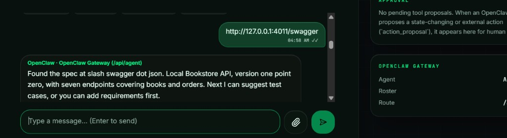
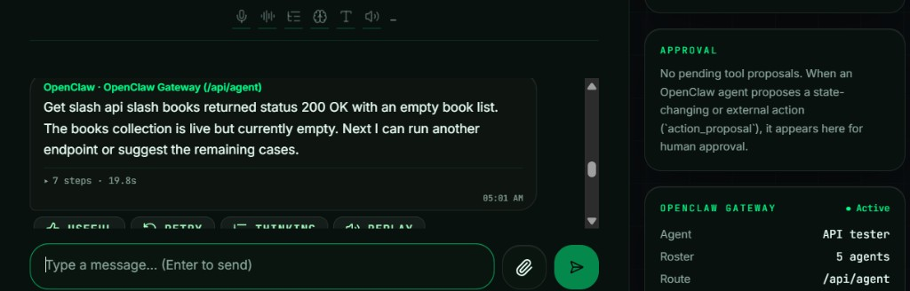
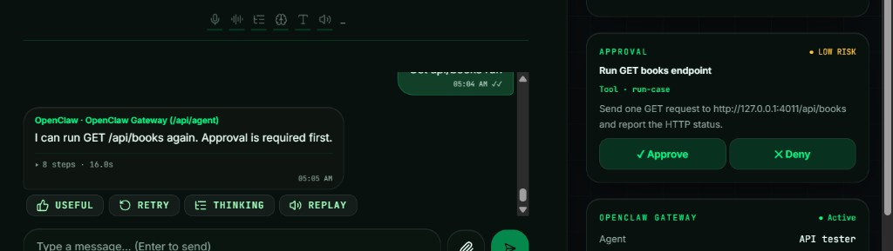

# 🎙️ Testing Agent

A voice API tester for the Dark Coders console.

## 💡 Idea

One agent, **API tester**, checks the API whose Swagger or OpenAPI JSON URL you give it.

- 📥 **fetch-spec** downloads that document and lists only the endpoints the parser found. For `http://127.0.0.1:4011/swagger` it reported the Local Bookstore API, version 1.0.0, with seven endpoints:

  
- 🧪 **suggest-cases** suggests a success case, a missing-required-field case, and an auth case only when the spec declares security. You can type extra requirements. After `GET /api/books` returned an empty list, the tester offered to suggest the remaining cases:

  
- ▶️ **run-case** sends one request only after you approve it, then reports the real status. The approval card for `GET /api/books` is the example:

  
- 📊 **write-report** saves the analysis only after a separate approval. An example is [`Testing-Agent-main/openclaw/reports/analysis-report.md`](Testing-Agent-main/openclaw/reports/analysis-report.md).

Ask it to scan the Swagger URL. It speaks the endpoint count, then offers the next step.

## 🎤 How I run voice

I use Whisper for speech recognition. To avoid running the model on this computer, it runs in a [Colab notebook](https://colab.research.google.com/drive/1jNvVrO3vogy7DY1EViBYRe3Ch7N8ias8?usp=sharing). Put your own ngrok token in that notebook first, then run it. ngrok gives the notebook a public address, and the console calls that address.

In **Settings → Voice & Agents**, set **Speech recognition** to **Local · Whisper-compatible server**. Paste the ngrok address into **ASR server base URL**.

Hold the microphone and speak. The console shows **Received — voice note**, then **Transcribing**. That step sends the recording to the Colab notebook through ngrok. Whisper turns it into text.

## 🔗 How it connects

The console does not run the skills. `Testing-Agent-main/src/routes/api/agent.ts` sends the chat to the OpenClaw gateway at `http://localhost:18789` with model `openclaw/default`. The gateway reads `Testing-Agent-main/openclaw/` and hands the four skills to the model.

`OPENCLAW_API_KEY` in `.env` must be the gateway token. The agent workspace must be the `Testing-Agent-main/openclaw` folder. Setup steps are in `Testing-Agent-main/openclaw/README.md`.

A Cursor agent drafted the agent instructions, the four skills, and the parser. The parser tests check that the endpoint list comes from the document.

## 📁 What is here

- 🖥️ `Testing-Agent-main` — the voice console, the API tester, and its skills.
- 🧪 `demo-darkcoders-test` — a small local backend whose Swagger URL the tester can scan.

## ✨ Extensions

- 🔐 **Login.** The runner attaches a token when an API requires one. The token stays out of the chat, the spoken reply, and the model prompt. You still approve the call first.
- 🛠️ **More skills and tools.** New rules and actions are added when a real project needs them.
- ⚠️ **Real side cases.** Duplicates, expired tokens, wrong roles, slow replies, and data left by an earlier test. The runner suggests them. The analyst shows which failed.
