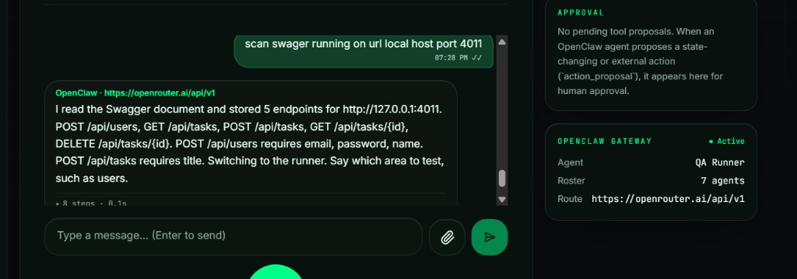
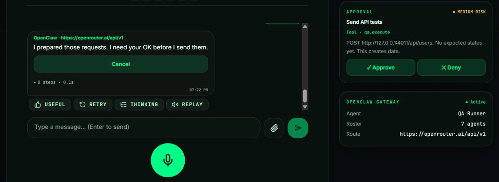
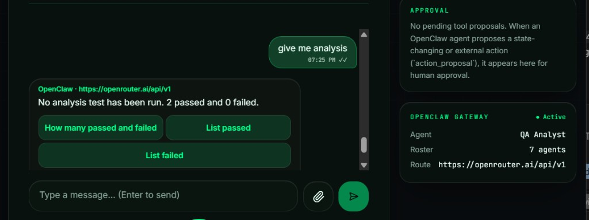
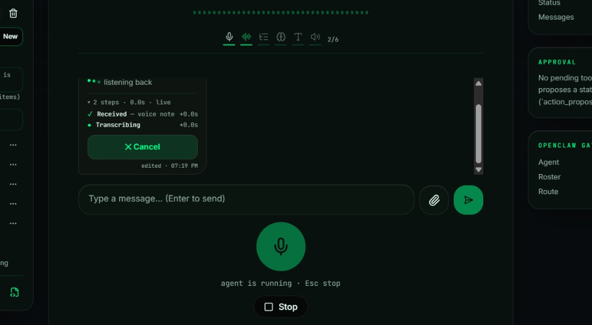

# 🎙️ Testing Agent

A voice QA squad for the Dark Coders console.

## 💡 Idea

Three agents test the API you point them at.

- **QA Reader** takes a Swagger URL. It fetches that spec, follows the schemas, and stores it. If something important is missing, it asks.

Say **scan swagger running on url local host port 4011**. In this example the reader stores 5 endpoints for `http://127.0.0.1:4011`: `POST /api/users`, `GET /api/tasks`, `POST /api/tasks`, `GET /api/tasks/{id}`, and `DELETE /api/tasks/{id}`. It notes that users need email, password, and name, and that tasks need a title. Then it switches to the runner.

- ▶️ **QA Runner** shows the areas from the spec. You pick one. It suggests test cases, and you can add your own. It sends a request only after you approve, then shows the status and the response. You say if that result was right.

The runner prepares the call and waits. In this example it wants to `POST http://127.0.0.1:4011/api/users`. The approval card says this creates data. **Approve** sends it. **Deny** sends nothing.

- 📊 **QA Analyst** reports which runs matched and which failed, from your feedback and the real responses. It does not edit application code.

Ask **give me analysis**. In this example the analyst says 2 passed and 0 failed, and offers **How many passed and failed**, **List passed**, and **List failed**.

## 🎤 How I run voice

I Use WhisperModel Speech recognition .to avoid run model local ,  i  runs in a [Colab notebook](https://colab.research.google.com/drive/1jNvVrO3vogy7DY1EViBYRe3Ch7N8ias8?usp=sharing). Put your own ngrok token in that notebook first, then run it. ngrok gives the notebook a public address, and the console calls that address.

In **Settings → Voice & Agents**, set **Speech recognition** to **Local · Whisper-compatible server**. Paste the ngrok address into **ASR server base URL**.

Hold the microphone and speak. The console shows **Received — voice note**, then **Transcribing**. That step sends the recording to the Colab notebook through ngrok. Whisper turns it into text.

## 🔗 How I integrate my agents

The voice model only turns speech into text. A second model writes the reply.

I use **OpenRouter** for that reply. Its cloud address is `https://openrouter.ai/api/v1`. In **Settings → Models**, I choose OpenRouter, paste my OpenRouter key, and pick a model. The console sends the conversation there. OpenRouter runs the model and sends the answer back. The console then speaks that answer.

I also tried **OpenClaw**. That is a gateway on this computer, usually `http://localhost:18789`. The console can send the same conversation to that gateway instead of OpenRouter. OpenRouter is the path I use. OpenClaw is the other path I tried.

## 📁 What is here

- 🖥️ `Testing-Agent-main` — the voice console and the starting QA squad (agents, skills, and session).
- 🧪 `demo-darkcoders-test` — a small local backend. The reader takes its Swagger URL.

## ✨ Extensions

- 🔐 **Login.** The runner attaches a token when an API requires one. The token stays out of the chat, the spoken reply, and the model prompt. You still approve the call first.
- 🛠️ **More skills and tools.** New rules and actions are added when a real project needs them.
- ⚠️ **Real side cases.** Duplicates, expired tokens, wrong roles, slow replies, and data left by an earlier test. The runner suggests them. The analyst shows which failed.
